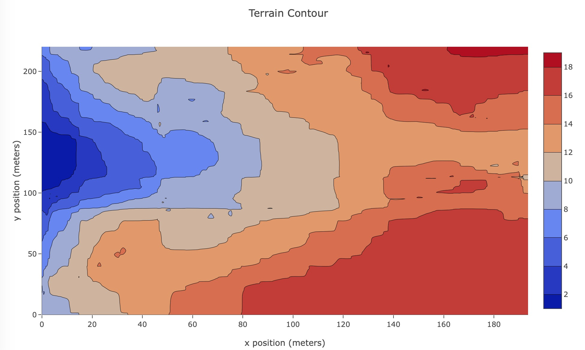
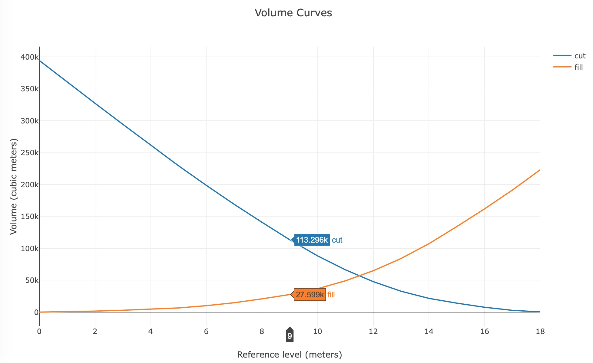
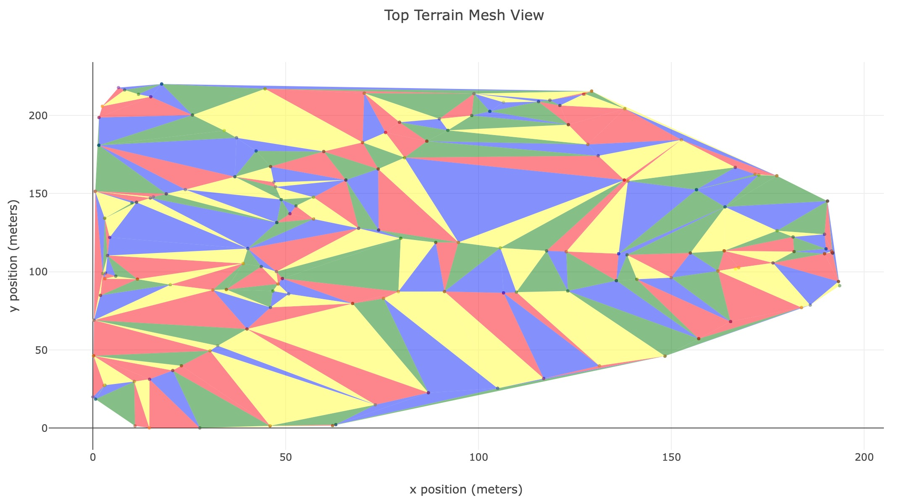
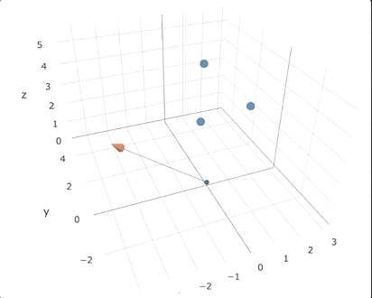
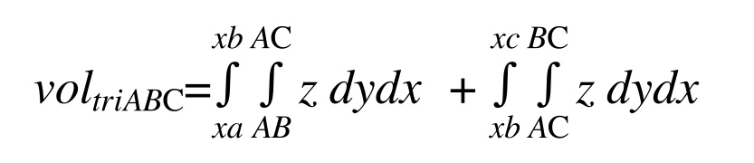

# Cálculos de Volúmenes para Modelos Digitales de Elevación en Python (**volpy**)

**Consulta esta documentación en [GitHub Pages](https://agu3rra.github.io/volpy)! Gráficos interactivos disponibles.**

El propósito de este proyecto en Python es proporcionar los medios para calcular volúmenes a partir de un Modelo Digital de Elevación ([DEM](https://en.wikipedia.org/wiki/Digital_elevation_model)) representado por una Red Irregular Triangulada ([TIN](https://en.wikipedia.org/wiki/Triangulated_irregular_network)).

Su objetivo principal es proporcionar estimaciones de volumen suficientemente precisas a partir de levantamientos topográficos para áreas de obras de construcción donde se requiera nivelación del terreno previo a la actividad constructiva.






# Instalación
```bash
$ pip install volpy
```

# Ejemplos

## Demostración rápida

```Python
import volpy as vp
vp.demo()
```

## Caso de uso simple

```Python
import volpy as vp
survey = vp.load_survey('survey_data.csv')
mesh = vp.terrain_mesh(survey.data)
survey.get_bounds()
> 'x=250.13, y=402.14, z=11.54'
# Gráficos del levantamiento
plots = vp.terrain_plots(survey)
plots.scatter3d()
plots.contour()
plots.profile()
plots.mesh_plot()
vol_curves = mesh.get_volume_curves(step=1.0)
mesh.plot_curves(vol_curves)

# Solo un volumen a partir de la malla
mesh.get_volume()
```

De forma predeterminada, volpy aplica sus cálculos en un [Sistema de Coordenadas Cartesiano](https://en.wikipedia.org/wiki/Cartesian_coordinate_system). Si estás trabajando con datos de levantamiento obtenidos desde un [GPS](https://en.wikipedia.org/wiki/Global_Positioning_System), es probable que sus puntos estén representados en un [Sistema de Coordenadas Geográficas](https://en.wikipedia.org/wiki/Geographic_coordinate_system). Para convertirlo, utiliza el siguiente modificador al cargar los datos.

```Python
>>> survey = vp.load_survey('survey_data.csv', coordinates=vp.CoordinateSystem.GEOGRAPHIC)
```

# Definiciones Clave

## Levantamiento topográfico
Un proceso mediante el cual se recogen puntos de un terreno de interés con el fin de formar una representación del mismo.

## Nivelación de terreno
En el contexto de la construcción, la nivelación de terreno es un proceso mediante el cual un terreno determinado puede ser remodelado para adaptarse a una forma, pendiente o nivel proyectado deseado. Generalmente se lleva a cabo mediante el uso de maquinaria pesada para mover materiales del terreno, ya sea desde el interior del mismo (redistribución de suelo) o utilizando material externo.

## Volúmenes de Corte/Relleno
En el contexto de la nivelación de terreno, el volumen de corte se refiere al material del terreno que debe ser **removido** para contribuir a remodelar el terreno hacia un nuevo estado deseado. Se trata de eliminar el exceso. Por el contrario, los volúmenes de relleno representan el material que debe ser **agregado** al terreno para alcanzar este mismo objetivo. En términos prácticos, se trata de cubrir los huecos en el terreno.

# Método de Cálculo de Volúmenes

Durante la mayoría de los estudios universitarios se nos enseña a calcular integrales en una serie de ecuaciones diferentes. Pero el mundo real no nos entrega ecuaciones; nosotros debemos idear las ecuaciones para modelarlo. Esta fue una de las partes más gratificantes de este proyecto: traducir un conjunto de puntos en el espacio a ecuaciones y aplicar conceptos básicos de [álgebra lineal](https://en.wikipedia.org/wiki/Linear_algebra) y [cálculo integral](https://en.wikipedia.org/wiki/Integral) a ellos para obtener volúmenes y curvas de [corte/relleno](https://en.wikipedia.org/wiki/Cut_and_fill) que puedan ser utilizadas en obras de construcción que involucren [movimiento de tierras](https://en.wikipedia.org/wiki/Earthworks_(engineering)).

## En resumen
1. De puntos a triángulos.
2. De triángulos a ecuaciones de planos.
3. De triángulos y planos a una suma de volúmenes.

## Paso 1: De puntos a triángulos
La secuencia de puntos en el espacio 3D, representados cada uno por una terna `(x,y,z)`, se agrupa en una malla utilizando la [triangulación de Delaunay](https://en.wikipedia.org/wiki/Delaunay_triangulation) en las coordenadas `(x,y)`. Este proceso genera una colección de puntos agrupados en 3 conjuntos de coordenadas 3D, cada uno representando un plano triangular en el espacio 3D:  
`[(xA,yA,zA), (xB,yB,zB), (xC,yC,zC)] = [A,B,C]`  

Así es como se ve cuando se observa desde arriba:  


## Paso 2: De triángulos a ecuaciones de planos
La ecuación del plano `z=f(x,y)` se obtiene para cada grupo de 3 puntos distintos (triángulos) en el espacio 3D aplicando álgebra lineal básica. Dada la colección anterior de puntos `[A, B, C]` en el sistema cartesiano:  
1. Los vectores AB y BC se determinan utilizando sus coordenadas.
2. El [producto cruz](https://en.wikipedia.org/wiki/Cross_product) AB x BC genera un vector perpendicular representado por constantes numéricas `(p,q,r)`.
3. Finalmente, la ecuación del plano correspondiente se da por:  
> p*(x-xo) + q*(y-yo) + r*(z-zo) = 0  
donde `(xo,yo,zo)` puede ser cualquiera de los 3 puntos A, B o C del plano.

En el GIF a continuación, el triángulo ABC está representado por los puntos azules y el vector normal `(p, q, r)` está representado por la línea azul con una punta naranja.



## Paso 3: De triángulos y planos a una suma de volúmenes
Dada la ecuación del plano, podemos aislar z y obtener una función `z=f(x,y)` sobre la cual se aplica la integral doble para calcular el volumen bajo el plano triangular hasta el plano perpendicular al eje XY que pasa por la coordenada de elevación más baja (z) del levantamiento.  

El volumen de cada triángulo individual se obtiene mediante la suma de 2 integrales dobles. Por lo tanto, para un triángulo con vértices ABC y su plano determinado por `z=f(x,y)`, los límites de la integral doble para un área triangular se determinan de la siguiente manera:  
  

## De Coordenadas GPS a Cartesiana.
En el caso de que el [levantamiento topográfico](###-Terrain-survey) se ejecute a través de un dispositivo GPS (el caso más común), se requiere un paso adicional antes de aplicar el cálculo de volúmenes: [proyección cartográfica](https://en.wikipedia.org/wiki/Map_projection).

Para los fines de este proyecto, se utilizó el [Universal Transverso de Mercator](https://en.wikipedia.org/wiki/Universal_Transverse_Mercator_coordinate_system) para convertir desde coordenadas GPS (latitud, longitud, elevación) a un sistema de coordenadas cartesianas, que es lo que espera el algoritmo en el [paso 1](###-Step-1:-From-points-to-triangles).
